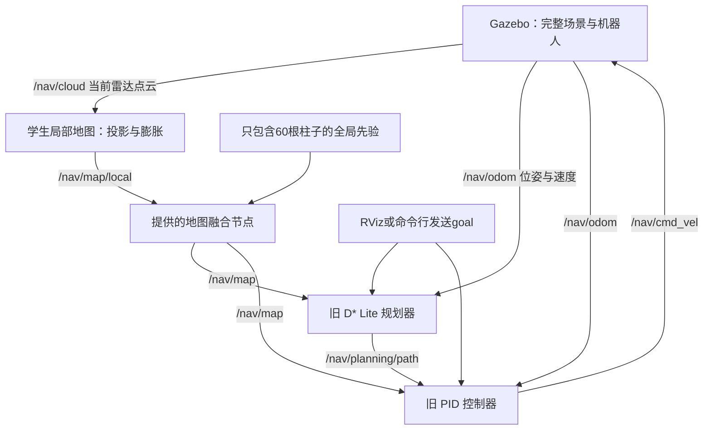

# Trident 控制组导航大作业

本作业将带你走完一次导航模块开发流程：认识工程结构，启动仿真和调试工具，根据实时雷达点云实现局部障碍地图，再用提供的规划器和控制器验证避障与到点效果。

场景共有120根柱子，机器人只预先知道其中60根的位置。初始代码能够根据这张不完整的全局地图规划并行驶，但可能撞上未收录的柱子。你的任务是让机器人通过雷达发现这些障碍，实时更新局部地图，并将结果接入导航闭环。

建议按以下顺序阅读和操作：

1. 阅读第1节，理解模块分工、数据流和作业边界。
2. 阅读第2节，认识 ROS 2、Gazebo 和 RViz2。
3. 按第3节逐个启动模块，发送目标，观察未完成作业时的表现。
4. 按第4节实现、编译和调试地图模块；详细要求见地图包 README。
5. 按第5节排查问题，最后按第6节运行自检并准备提交。

## 1. 项目结构与开发工作流

### 1.1 五个包分别负责什么

本仓库沿用导航框架的分包方式，每个 ROS 包都有独立的 `package.xml`、`CMakeLists.txt` 和 `launch/`。作业将这些包集中交付在一个 Git 仓库中。

```text
.
├── src/
│   ├── nav/
│   │   ├── obstacle-map/nav_obstacle_map/  # 学生地图算法、ROS封装、全局先验融合
│   │   ├── planning/nav_planning/         # 旧 D* Lite 路径规划
│   │   ├── control/nav_legacy_control/    # 旧 PID 路径跟踪
│   │   └── simulation/nav_simulation/    # Gazebo场景、机器人、雷达与底盘适配
│   └── nav_bringup/                       # 模块组合启动、RViz显示配置
├── scripts/                              # Docker开发入口与最终自检
├── config/components.yaml                # 与统一框架的组件映射
├── docs/                                 # 开发说明与来源说明
└── Dockerfile                            # 可复现的编译和运行环境
```

先阅读自己负责的地图包，再根据调试需要查看上下游包：

| 子项目与文档 | 本作业中的职责 | 你需要完成的工作 |
| --- | --- | --- |
| [nav_obstacle_map](src/nav/obstacle-map/nav_obstacle_map/README.md) | 点云投影、局部膨胀图、全局先验融合 | 实现 `project_cloud`、`inflate_grid` 两个函数，验证实时更新 |
| [nav_planning](src/nav/planning/nav_planning/README.md) | 根据导航图、当前位置和目标生成路径 | 理解输入输出，使用路径判断地图是否正确，无需重写规划器 |
| [nav_legacy_control](src/nav/control/nav_legacy_control/README.md) | 根据路径输出底盘速度 | 观察跟踪、到点与停车状态，无需重写控制器 |
| [nav_simulation](src/nav/simulation/nav_simulation/README.md) | 提供完整物理场景、仿真传感器和底盘 | 启动环境、观察实际运动和接触，保持完整场景 |
| [nav_bringup](src/nav_bringup/README.md) | 提供组合入口与RViz配置 | 使用显示配置检查地图、路径、位姿并发送目标 |

统一框架还包含定位、策略、雷达驱动和板间通信等逻辑组件。本作业用仿真真值提供定位、Gazebo提供雷达与底盘、手动goal提供任务，不需要另外编写这些包。映射见[组件清单](config/components.yaml)。

### 1.2 一次导航任务如何流转



地图节点使用里程计决定局部窗口位置。融合节点保留全局已知障碍，并叠加当前局部障碍。规划与控制通过路径话题连接，分别作为独立进程运行。RViz订阅这些数据，帮助你检查每一步的结果。

### 1.3 你要完成什么，如何判断完成

必做工作集中在 [`student_map.py`](src/nav/obstacle-map/nav_obstacle_map/python/nav_obstacle_map/student_map.py) 的两个函数：将当前三维点云投影为二维占据栅格，再进行圆盘膨胀。具体输入、返回值、坐标、边界与测试要求见[地图包作业说明](src/nav/obstacle-map/nav_obstacle_map/README.md)。

无需实现SLAM、历史衰减、遮挡推理、射线清空或ESDF，也无需修改提供的规划、控制、融合节点和仿真场景。不能通过读取完整柱子布局、补全先验、发布固定地图或绕过学生地图输出完成任务。

开发按以下流程循环：**修改函数 → 运行算法测试 → 编译地图包 → 重启地图模块 → 在RViz检查当前局部图 → 发goal观察Gazebo运动 → 根据结果继续修改**。完成后再运行最终自检，并记录可复现的构建和任务结果。

## 2. 认识 ROS 2、Gazebo 与 RViz2

### 2.1 ROS 2：让各个模块交换数据

ROS 2提供机器人软件的通信与开发工具。本作业使用 **ROS 2 Humble**。地图、规划、控制都作为节点运行，节点通过约定类型的话题交换点云、地图、路径和速度。

- **包（package）**：组织源码、配置和启动文件的单位，例如 `nav_obstacle_map`。
- **节点（node）**：运行中的模块，例如 `student_mapper`。
- **话题（topic）与消息（message）**：数据通道及其格式，例如 `/nav/map` 使用 `nav_msgs/msg/OccupancyGrid`。
- **launch**：按配置启动一个或多个节点，例如 `ros2 launch nav_obstacle_map mapping.launch.py`。
- **参数（parameter）**：节点配置，例如分辨率、膨胀半径和 `use_sim_time`。
- **坐标系与TF**：描述数据的位置和坐标关系。本作业地图与目标使用 `map`，机器人底盘使用 `base_link`。

阅读入口：[ROS官网](https://www.ros.org/)、[ROS 2 Humble官方文档](https://docs.ros.org/en/humble/)、[Humble基础教程](https://docs.ros.org/en/humble/Tutorials/Beginner-CLI-Tools.html)。先了解节点、话题、参数和launch，就可以开始本作业。

### 2.2 Gazebo：运行虚拟机器人和物理场景

Gazebo负责模拟场景、机器人运动和传感器。本作业使用 **Gazebo Fortress**：完整柱林位于其中，底盘执行速度指令，雷达随机器人运动产生扫描。你用它观察车是否移动、绕行或与柱子发生接触。

启动环境后，应看到Gazebo原生窗口、柱子和机器人。Gazebo暂停时，仿真时间和传感器更新也会暂停。先确认场景在播放，再排查下游导航问题。

阅读入口：[Gazebo官网](https://gazebosim.org/)、[Fortress官方文档](https://gazebosim.org/docs/fortress/)、[Fortress入门](https://gazebosim.org/docs/fortress/getstarted/)。本仓库使用Fortress对应的 `ign gazebo` 命令，按本作业提供的launch启动即可。

### 2.3 RViz2：观察算法收到和产生的数据

RViz2是ROS 2的可视化工具。本作业用它显示雷达点云、全局先验、局部地图、融合地图、规划路径和机器人位姿，并通过目标工具发布goal。

Gazebo中的柱子代表完整仿真场景；RViz中的地图代表导航当前掌握的信息。调试时对照两个窗口：若Gazebo中有柱子，而RViz的局部地图没有对应障碍，就应检查投影、坐标、高度过滤或消息更新。RViz本身不计算物理运动或地图算法。

阅读入口：[RViz2官方项目](https://github.com/ros2/rviz)、[RViz官方用户指南](https://docs.ros.org/en/humble/Tutorials/Intermediate/RViz/RViz-User-Guide/RViz-User-Guide.html)。RViz2属于ROS生态，其官方使用文档发布在ROS文档站。

### 2.4 这三个工具在本作业中的配合

| 工具 | 你主要用它做什么 | 应看到的结果 |
| --- | --- | --- |
| ROS 2 | 启动节点、查看话题、发送目标 | 节点存在，消息持续更新，类型与坐标约定一致 |
| Gazebo | 运行完整场景与机器人 | 真实仿真中的底盘运动、障碍和物理接触 |
| RViz2 | 检查算法数据、交互发goal | 点云、地图、路径和位姿对齐，局部图随扫描更新 |

Docker将上述工具和本项目的依赖装在同一个环境中。宿主机负责运行Docker和显示窗口，编译、ROS命令和算法测试都在容器内执行。

## 3. 配置环境，逐个启动模块


日常开发先使用本节的分模块入口。环境不会自动发送目标，可以先在 RViz 中指定目标观察全局规划，再完成地图模块验证避障效果。第6节的一键脚本用于最后自检。

### 3.1 构建并进入 Docker

环境要求：Linux 图形桌面（支持 X11 或 XWayland）、Docker Engine、宿主机 `xauth`。建议至少8 GB可用内存、15 GB可用磁盘；宿主机无需安装 ROS、Gazebo 或 RViz。NVIDIA显卡还需宿主机的 NVIDIA Container Toolkit（提供 `nvidia-ctk`）；启动脚本会传入显卡设备与驱动。

若下载的是课程材料ZIP，先解压并进入 `control-navigation-assignment/`。ZIP不包含Git历史，需在宿主机为自己的作业初始化仓库：

```bash
git init
git add .
git commit -m "Initialize navigation assignment"
```

若提示缺少Git身份，按Lecture 0配置自己的姓名与邮箱后重新提交。开发中定期commit；最终提交脚本需要在有初始commit的Git工作区运行。通过Git clone获取工程时无需重复初始化。

在作业仓库根目录执行：

```bash
# 宿主机缺少 xauth 时先安装。
sudo apt-get install xauth

# 镜像包含 ROS 2 Humble、Gazebo Fortress、RViz2 和作业源码。
docker build -t trident-control-course:2026 .

# 打开容器终端并配置图形显示。
./scripts/dev.sh
```

首次构建需要联网。`dev.sh` 将当前桌面的显示授权传入容器；容器名称为 `trident-course`。以下各终端都进入这个容器，不要重复创建多个同名实例。若需完全重新构建，可为 `docker build` 加上 `--no-cache`。

### 3.2 终端 A：启动 Gazebo

在刚进入的容器终端执行：

```bash
ros2 launch nav_simulation environment.launch.py
```

此命令打开 **Gazebo 原生窗口**，加载全部120根柱子和全向底盘，运行物理仿真并发布 Gazebo 雷达点云、里程计和 `/clock`。机器人初始位置为 `(29.325,8.475)`，不会自动接收任务。确认 Gazebo 已运行；暂停时点击窗口下方的播放按钮。

Gazebo 用于查看三维场景、底盘运动和物理接触。查看学生地图和规划路径使用下文的 RViz。

### 3.3 终端 B：启动地图模块

新开一个宿主机终端：

```bash
docker exec -it trident-course /course-entrypoint.sh bash
ros2 launch nav_obstacle_map mapping.launch.py use_sim_time:=true use_global_prior:=true
```

该命令启动学生局部地图和提供的全局先验融合。未完成两个函数时会显示 `TODO A/B`，此时仍会将半柱全局先验发布为导航图，发布 goal 后机器人可以规划和行驶，但无法感知先验缺失的柱子，可能发生碰撞。完成局部地图后，融合节点会自动叠加当前扫描中的障碍。

### 3.4 终端 C：启动规划模块

```bash
docker exec -it trident-course /course-entrypoint.sh bash
ros2 launch nav_planning planning.launch.py use_sim_time:=true
```

规划包读取地图、里程计和目标，发布 `/nav/planning/path`，不直接控制底盘。

### 3.5 终端 D：启动控制模块

```bash
docker exec -it trident-course /course-entrypoint.sh bash
ros2 launch nav_legacy_control control.launch.py use_sim_time:=true
```

控制包接收规划路径并发布 `/nav/cmd_vel`。收到目标、有效地图和有效路径之前保持零速度。

### 3.6 终端 E：启动 RViz，发送目标

```bash
docker exec -it trident-course /course-entrypoint.sh bash
ros2 launch nav_bringup rviz.launch.py
```

配置已设置 `Fixed Frame=map`、仿真时间和以下显示：

| 显示项 | 话题 | 用途 |
| --- | --- | --- |
| Global prior | `/nav/map/prior` | 只包含60根柱子的全局先验 |
| Navigation map | `/nav/map` | 规划实际使用的融合障碍地图 |
| Local inflated map | `/nav/map/local` | 学生输出的滚动局部膨胀图，默认关闭，可勾选 |
| LiDAR points | `/nav/cloud` | 按扫描时间转换到 `map` 的三维点云 |
| Planned path | `/nav/planning/path` | 旧 D* Lite 的几何路径 |
| Robot pose | `/nav/odom` | 机器人位置与朝向箭头 |
| TF | `/tf`、`/tf_static` | 坐标关系，默认关闭，可勾选 |

在 RViz 工具栏选择 **2D Goal Pose（SetGoal）**，在地图中的空闲位置按住鼠标左键并拖动后松开。该工具直接向 `/nav/goal` 发布目标。可以重复选择目标切换任务；本题只验收目标位置，不要求终点朝向。建议先测试目标 `(1.475,4.375)`，不要把目标放到柱子、膨胀区或场地范围外。

也可以在另一个容器终端用命令发送同一个目标：

```bash
ros2 topic pub --once -w 1 /nav/goal geometry_msgs/msg/PoseStamped \
  '{header: {frame_id: map}, pose: {position: {x: 1.475, y: 4.375, z: 0.0}, orientation: {w: 1.0}}}'
```

单独停止某个模块后，可以只重启对应的 launch。不要同时启动总入口或验收脚本，避免同一模块重复运行。退出时分别 Ctrl+C 停止各个 launch，最后在终端 A 执行 `exit`，容器自动删除。

## 4. 实现地图并反复调试

先读完[地图包README](src/nav/obstacle-map/nav_obstacle_map/README.md)，确认两个函数的输入输出约定。建议先完成投影并检查原始栅格，再完成膨胀，最后验证两者组合的避障效果。

### 4.1 在宿主机编辑，在容器中编译

日常改代码推荐使用源码挂载模式。若已按第3节启动普通容器，先在各终端Ctrl+C停止模块，再退出终端A；随后在**宿主机作业根目录**执行：

```bash
TRIDENT_DEV=1 ./scripts/dev.sh
```

该模式将宿主机的 `src/` 挂载到容器的 `/opt/nav_ws/src/`。使用编辑器修改宿主机中的学生函数，修改会保留在本地仓库。容器里其他目录在退出后会删除，不要仅在普通容器内保存作业答案。

修改后，在**容器的 `/opt/nav_ws`** 中执行：

```bash
# 先停止终端B的地图launch，再测试、编译。
PYTHONPATH=src/nav/obstacle-map/nav_obstacle_map/python python3 -m pytest -q src/nav/obstacle-map/nav_obstacle_map/tests/test_student_map.py
colcon build --packages-select nav_obstacle_map
source /opt/nav_ws/install/setup.bash
ros2 launch nav_obstacle_map mapping.launch.py use_sim_time:=true use_global_prior:=true
```

上述测试通过 `PYTHONPATH` 直接读取当前源码，避免误测上一次安装的版本。普通安装会复制Python文件到 `install/`，因此改完源码后必须重新编译并重启地图节点。重新打开的容器终端使用 `/course-entrypoint.sh bash` 加载已安装环境。更详细的说明见[开发指南](docs/development.md)。

### 4.2 每轮调试要观察什么

1. 检查 `/nav/cloud` 是否持续更新、`/nav/odom` 是否与机器人位置一致。
2. 在RViz添加或切换 `/nav/map/raw`，检查柱子是否投影到正确格子，地面是否被高度过滤掉。
3. 勾选 `/nav/map/local`，检查膨胀形状、窗口移动和当前扫描更新；障碍不应因历史累积而一直残留。
4. 切换到 `/nav/map`，确认已知柱子保留、局部新障碍加入。
5. 用同一个goal比较未实现地图与实现后的路径和运动。不要以机器人能够移动作为作业完成证明。

首次有效局部图到达前，导航可只使用全局先验；收到有效局部图后将依赖局部更新，局部输入断流会停车。完整规则见地图包README。

## 5. 调试与常见问题


- **Gazebo没有窗口**：从图形桌面启动 `scripts/dev.sh`，检查宿主机 `echo "$DISPLAY"`，确认有 `xauth`。SSH或无桌面服务器需要自行提供图形显示环境。
- **RViz中没有数据**：确认 Fixed Frame 是 `map`，Gazebo正在播放，模块均启用 `use_sim_time:=true`。查看 `/clock`、`/nav/odom`、`/nav/cloud` 是否持续更新。
- **只有先验，没有局部图**：学生函数仍抛出 TODO 时属于预期状态，此时仍可发 goal 测试全局规划，但缺失柱子没有避障保障。先验不代表学生任务完成。若路径为空，再检查 goal、里程计、仿真时钟以及起终点是否落在障碍中。
- **查看局部图与融合图差异**：在 RViz Displays 中分别勾选图层，避免多层地图重叠导致误读。地图层用 Reliable/Transient Local，点云用 Best Effort/Volatile。
- **目标未触发任务**：检查 RViz 目标工具的 Topic 是 `/nav/goal`，目标 frame 为 `map`，规划与控制节点均已启动。也可用上文命令行目标排查。
- **绕行失败或路径为空**：检查 floor 索引、XY排列、高度过滤、膨胀半径与目标占据状态。查看原始投影与膨胀图，不要硬编码场景。

常用命令：

```bash
ros2 node list
ros2 topic hz /nav/cloud
ros2 topic hz /nav/map
ros2 topic echo /nav/control/status
ros2 topic echo /nav/map/raw --once --field info
```

地图开发与重新编译步骤见第4节。若重新构建了镜像，需要退出并重新创建容器；已有容器仍保留创建时的镜像内容。

## 6. 最终自检与提交


先在 Gazebo 中完成一次手动目标任务，并保存 RViz 中地图、规划路径及到点结果。再停止上述各个 launch，执行自动自检；脚本会自行启动节点，不能与手动模块混跑。

```bash
# 学生算法单元测试；模板未完成时应失败。
PYTHONPATH=src/nav/obstacle-map/nav_obstacle_map/python python3 -m pytest -q src/nav/obstacle-map/nav_obstacle_map/tests/test_student_map.py

# 连续点云变化、窗口移动和时间戳测试。
python3 scripts/check_live_map.py

# 完整ROS闭环、速度上限、碰撞与断流停车自检。
python3 scripts/check_closed_loop.py
```

自动闭环脚本采用更小的墙体平面运动学夹具，便于快速重复自检；它不能替代 Gazebo 的物理场景验证。可用 `python3 scripts/check_closed_loop.py --diagnostic` 绕过学生地图，仅检查提供的导航基础设施，但不作为学生完成证明。

### 6.1 准备报告

将[报告模板](docs/report-template.md)复制为仓库根目录的 `report.md`，填写算法、复杂度、边界案例和任务观察：

```bash
# 宿主机，作业仓库根目录。
cp docs/report-template.md report.md
```

报告和源码修改应保存在宿主机。最终视频由下一步脚本自动生成，无需自行剪辑或手动打包。

### 6.2 一条命令自动验收、录制并压缩

在Linux图形桌面的**宿主机终端**运行。宿主机需安装Python 3、Git、Docker、`xauth`和带X11录制支持的FFmpeg：

```bash
sudo apt-get install python3 git xauth ffmpeg
python3 scripts/submit.py --student-id 你的学号或组号 --report report.md
```

`--student-id`请替换为实际编号，只使用字母、数字、下划线或短横线。开始前停止手动启动的各模块和其他仿真窗口，关闭与演示无关的窗口。脚本录制当前X11桌面，不录制音频；运行时保持桌面登录，不遮挡、最小化或关闭仿真与RViz窗口，也不要手动发goal或修改源码，以保持构建、测试和归档版本一致。

脚本依次完成：

1. 用当前仓库源码重新构建专用Docker镜像。
2. 运行学生算法测试、实时地图测试和运动学闭环自检，分别保存日志。
3. 在独立容器与ROS domain中启动真实Gazebo、地图、规划、控制及RViz，将两个原生窗口左右排列。
4. 自动发送固定目标 `(1.475,4.375)`，录制包含三维场景、地图、路径和机器人运动的 `final.mp4`；保存到点误差、碰撞观测、局部地图更新计数和轨迹。
5. 检查视频可完整解码，将源码、报告、视频、结果和日志压缩为ZIP，并校验ZIP完整性。

结果位于 `submissions/`，脚本最后打印实际路径：

```text
submissions/
├── 编号-时间-标识/          # 本次原始录像、结果和日志
└── 编号-时间-标识.zip      # 最终提交文件
```

**提交脚本生成的ZIP文件**。包内包含：

- `project/`：当前工作区的作业源码、启动配置、Dockerfile和文档，不包含Git历史、缓存、build/install/log或Docker镜像tar。
- `report.md`或 `report.pdf`：你填写的报告。
- `evidence/final.mp4`：脚本生成的Gazebo与RViz演示视频。
- `evidence/result.json`：本次真实物理任务结果；`trajectory.jsonl`记录位姿变化。
- `evidence/manifest.json`：实际镜像ID、Git版本及未提交改动、各项检查结果与最终是否通过。
- `evidence/*.log`及 `evidence/ros-logs/`：构建、测试、模块运行和录制日志。
- `SHA256SUMS.json`：包内文件校验值。

测试失败仍会继续录制任务；任务碰撞、超时、未产生有效局部图或其他环节失败时，脚本以非零状态退出，保留失败记录并打包，不将其标记为通过。图形环境或启动失败可能没有有效视频，应查看日志修复后重跑。先解压检查视频、结果和报告，确认正式验收通过后再提交。

默认任务上限为180秒仿真时间。`--skip-build`、`--skip-checks`和自定义目标只供排错使用，不计为正式验收通过。运行命令不使用这些选项即可。脚本只清理自己创建的运行容器，不停止已有开发容器。

评分：投影35分、膨胀30分、完整任务25分、可复现报告10分。教师会更换非方形尺寸、分辨率、边界点、半径和障碍分布复测，不要硬编码演示地图。

旧导航来源及改动范围见[来源说明](docs/provenance.md)。本仓库仅用于队内教学；仿真表现不代表真机验收。
